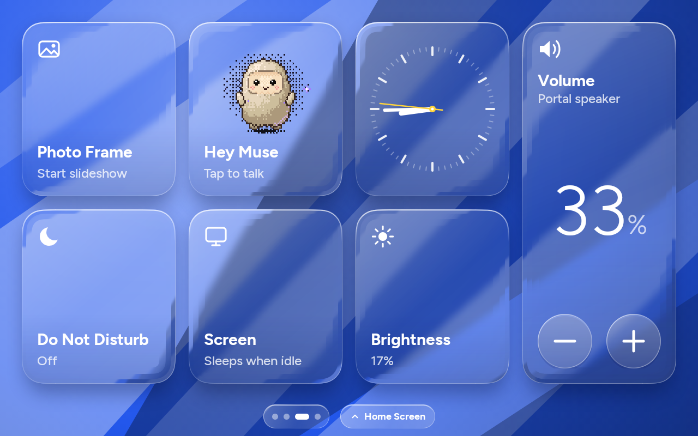
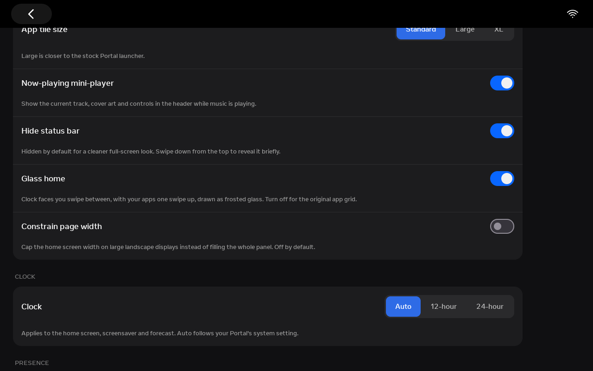
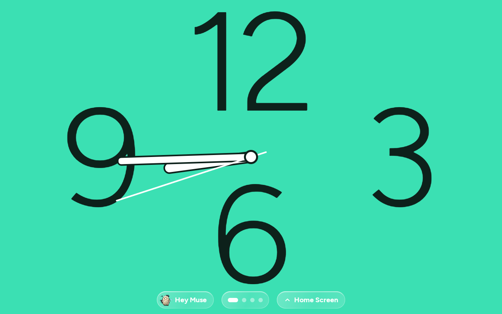
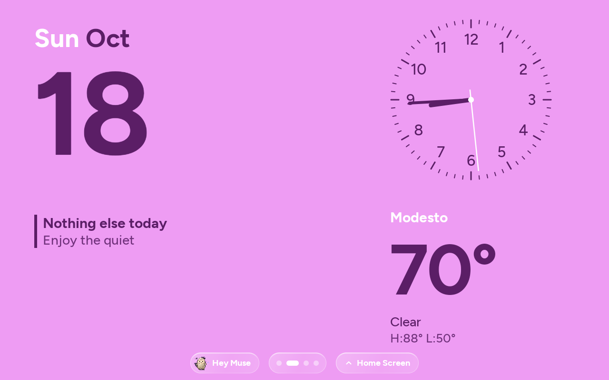
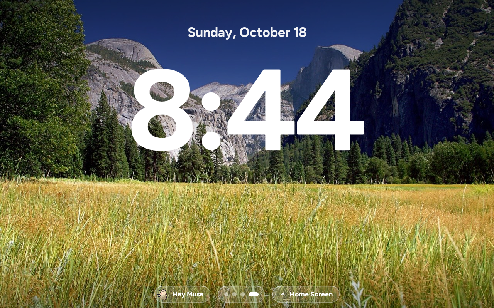
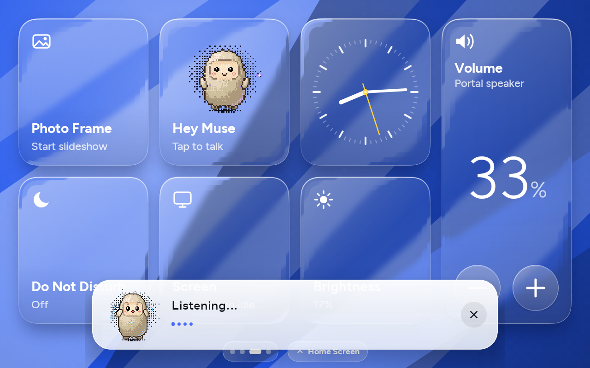
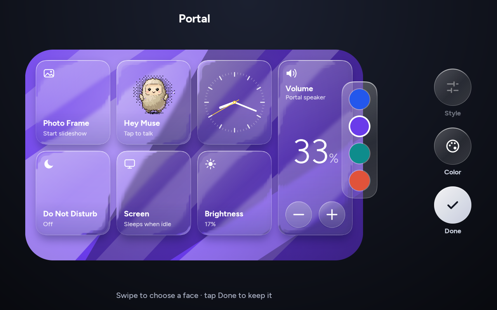
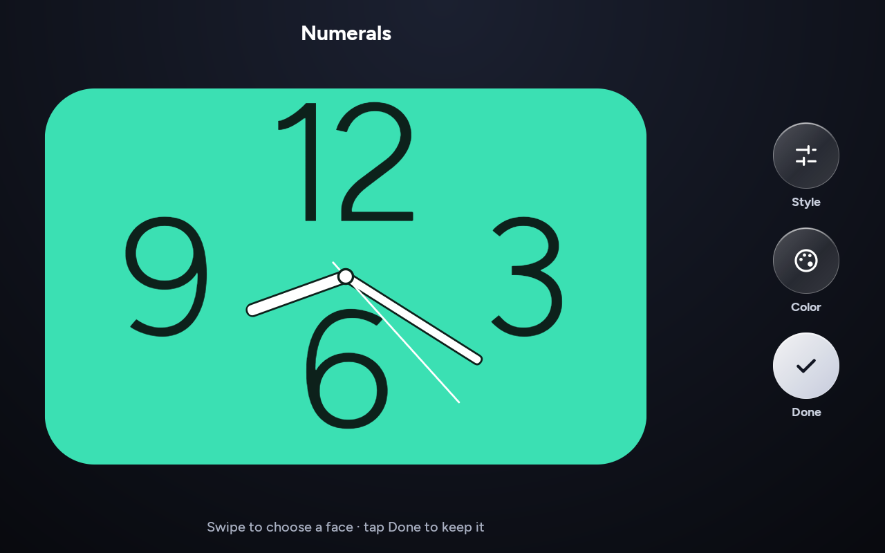
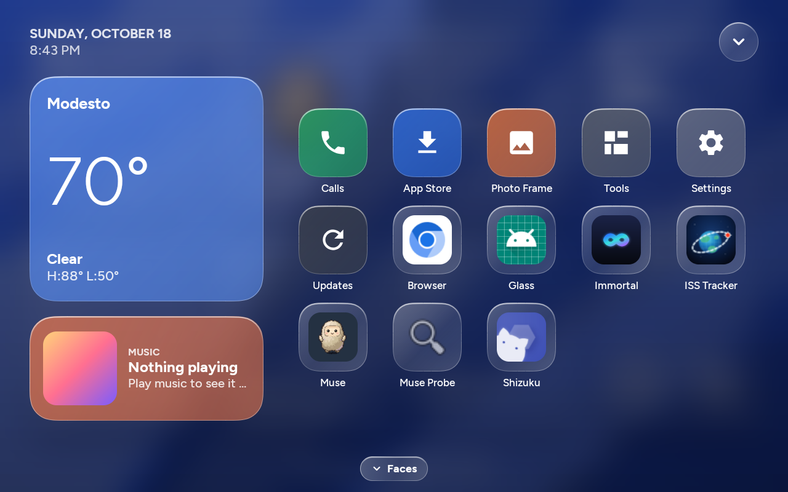

# Glass home

The Glass home is an alternative home screen for Immortal Glass: clock faces you swipe between, a personal Home Screen one swipe up, and tiles drawn as liquid glass. It is a separate screen from the original app grid, which is still there when you switch Glass off.

## Switching it on and off

Glass is on by default in this fork. To go back to the original grid, open the Home Screen, tap **Settings**, then **Immortal**, and turn off **Glass home** under Home screen. The original grid shows the next time you return home. To turn Glass back on, open **Settings > Immortal** from the grid and turn the switch on again.

## What's on it

Swipe left or right, or tap the page dots, to change face. The faces:

| Face | Shows |
| --- | --- |
| Portal | Glass tiles: Photo Frame (starts Immortal's photo frame), Hey Muse, an analog clock, Volume, Do Not Disturb, Screen (keeps the screen awake while home is showing) and Brightness (each tap steps Auto, 25, 50, 75, 100%) |
| Numerals | Giant 12, 3, 6 and 9 behind live hands |
| Modular | The date, an analog clock, today's events and the weather |
| Photo | A picture from your photo frame with a large clock over it |

| Numerals | Modular | Photo |
| --- | --- | --- |
|  |  |  |

Modular reads events from the calendar feed set in Screensaver settings, or from the Portal's own calendar when Immortal can read it. With neither it says so. Photo takes a picture from the photo frame's folder or cache, or one of the bundled photos, and never waits on the network.

Hey Muse sends the Muse app its wake broadcast, and Muse answers in its own card. The tile reads "Not installed" without Muse, and the pill under the other faces is hidden.

### Edit mode

Long-press a face. It shrinks into a card with Style, Color and Done beside it. Swipe to change faces while editing. Your face, colors and styles are saved.

| Colors | Style (light numerals) |
| --- | --- |
|  |  |

### Home Screen

Swipe up, or tap **Home Screen**, to open it over a blur of the current face. Swipe down, tap the chevron or tap **Faces** to go back. It has the weather, what's playing (tap to play or pause), and your apps. The built-in tiles are Calls (the stock Portal home, for calling), App Store, Photo Frame, Tools, Settings (Immortal, Screensaver and clock faces, Help and the system settings apps) and Updates. If Millennium is installed, a microphone button next to the chevron triggers it.

The photo frame, screensaver, overnight sleep, updates and app store work as they do with the original grid.

## How the glass renders on Android 9

The Portal runs Android 9, which has no live backdrop blur (`RenderEffect` arrived in Android 12). Every face owns its background, so the glass blurs that background once instead of blurring the screen every frame:

1. The background is painted to a screen-size bitmap: bold angled panels for Portal, the photo for Photo. Tile drop shadows are baked into it.
2. A 1/4-scale copy gets a light stack blur (radius 3) for the glass bodies. A 1/2-scale copy (radius 2) feeds the lens rings. This runs off the main thread in about 160 ms, once per background change.
3. Each tile draws its slice of the blurred copy through a `BitmapShader`, in a continuous-corner shape.
4. Three rings along the rim sample the backdrop from 10%, 22% and 38% further out, so panel edges bend as they cross into the glass.
5. Tint, an inner shadow, a top highlight and a 1 px rim go on top.

Each tile renders into its own layer, so pressing one redraws only that tile. The Home Screen's blur is a scaled-down screenshot of the face (`PixelCopy`), stack-blurred when you swipe up.

## Frame times

Measured on a Portal+ Gen-1 with `adb shell dumpsys gfxinfo` on a release build signed with the debug key (minify off, as Immortal ships). Each run is one scripted session. A frame is janky when it misses its deadline.

| Scenario (3 runs) | Janky frames | p50 | p90 |
| --- | --- | --- | --- |
| 16 tile presses on the Portal face | 10.0-10.5% | 8-9 ms | 16-19 ms |
| 8 face swipes around the carousel | 16.5-25.9% | 6-8 ms | 19-21 ms |
| 4 Home Screen open and close cycles | 12.0-22.8% | 8-9 ms | 20-28 ms |

The portal-glass prototype scored 10-16% janky (p50 7-8 ms) on the same press script. Two costs drove most of the swipe jank, and the code avoids both. A blurred text shadow at clock size was re-rasterised every frame, so Photo face transitions measured 48-51% janky until it became a scrim baked into the photo. A fade renders the whole screen offscreen each frame, so transitions slide without fading.
